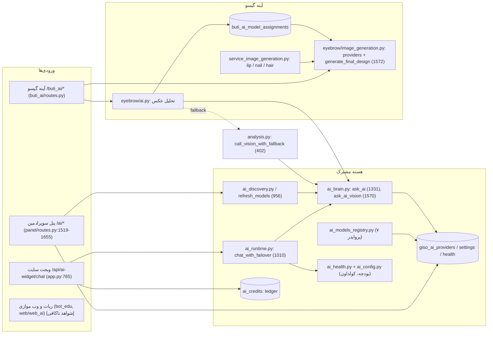

# گزارش ممیزی معماری هوش مصنوعی گیسو (Giso4)

| | |
|---|---|
| **تاریخ گزارش** | 2026-10-15 (Asia/Tehran) |
| **شاخه / کامیت مبنا** | `arena/7f567e47-giso4` در `837b917` |
| **نوع کار** | ممیزی فقط‌خواندنی؛ هیچ کد، تنظیمات ذخیره‌شده، فایل یا دیتابیسی تغییر نکرده |
| **روش** | خواندن کد، جست‌وجوی نماد (symbol) و بررسی گراف Graphify با تطبیق با کد |

## برچسب‌های یافته‌ها

| برچسب | معنی |
|---|---|
| **[کد تأیید شد]** | در کد `837b917` خوانده و با فایل و شماره خط مشخص شده است |
| **[ریسک]** | از روی کد استنباط شده؛ در اجرای واقعی بازتولید نشده |
| **[نیاز به تست اجرایی]** | فقط با اجرای واقعی (داده، شبکه، مدل زنده) قابل قضاوت است |
| **[شواهد ناکافی]** | در این ممیزی کافی خوانده نشده یا شاهدی برای قضاوت وجود ندارد |

> **محدودیت مهم:** این گزارش هیچ تست اجرایی، هیچ تماس زنده با پروایدرها و هیچ بررسی روی `giso/data/giso.db` زنده اجرا نکرده است. شماره خط‌ها مربوط به `837b917` هستند؛ گراف Graphify با این کامیت هم‌خوان نیست (بخش ۴).

---

## ۱. خلاصه مدیریتی

- **سه کار AI در کد جدا هستند:** (۱) **چت** از طریق `giso/ai_runtime.py::chat_with_failover` (خط ۱۰۱۰)؛ (۲) **تحلیل عکس** (عمومی در `giso/analysis.py` و مخصوص آینه گیسو در `giso/buti_ai/eyebrow/ai.py`)؛ (۳) **تولید تصویر نهایی** (`giso/buti_ai/eyebrow/image_generation.py::generate_final_design` خط ۱۵۷۲ و `giso/buti_ai/service_image_generation.py::generate_final_design` خط ۵۴۳). **[کد تأیید شد]**
- **اشتراک‌ها:** همه از `ai_brain.py` (`ask_ai` خط ۱۳۳۱، `ask_ai_vision` خط ۱۵۷۰) و جدول `giso_ai_providers` استفاده می‌کنند. تولید تصویر لب، ناخن و مو کد provider را از ماژول ابرو وام می‌گیرد (`service_image_generation.py` خط ۱۶). **[کد تأیید شد]**
- **مهم‌ترین ریسک‌ها:**
  1. مسیرهای آینه گیسو که AI هزینه‌دار صدا می‌زنند (`validate-photo`، `final`، `final/retry`) **بدون اعتبار، سهمیه یا rate limit** هستند؛ فقط POST نیاز به CSRF دارد. **[کد تأیید شد]** (R1)
  2. در ابرو، **هر خطای انتقال** روی پروایدر تصویر، یک تلاش دوم روی همان پروایدر می‌زند؛ یعنی یک timeout می‌تواند زمان را دو برابر کند. **[کد تأیید شد]** (R2)
  3. **دو تعریف جدا برای تشخیص مدل بینایی** با دو فهرست کلیدواژه متفاوت وجود دارد. کلیدواژه `image` می‌تواند مدل تولید تصویر را بینایی تشخیص دهد. **[کد تأیید شد / ریسک]** (R4)
  4. هنگام ذخیره اسلات مدل آینه، **قابلیت بینایی یا وجود پروایدر بررسی نمی‌شود**. **[کد تأیید شد]** (R5)
  5. حذف پروایدر، اسلات‌های آینه را پاک نمی‌کند (ولی runtime آن‌ها را بی‌صدا رد می‌کند). **[کد تأیید شد]** (R6)
  6. `mirror_output_validation` تعریف و در آمادگی نمایش داده می‌شود ولی **هیچ مصرف‌کننده runtime ندارد**. **[کد تأیید شد]** (R7)
- **چیزهایی که درست کار می‌کنند:** fallback غیر AI با برچسب `is_ai_generated=False` علامت خورده و در نمایش/دانلود استفاده می‌شود (`service_image_generation.py` حدود خط ۶۲۷؛ `downloads.py` خط ۷۴)؛ ویجت سایت CSRF و رزرو اعتبار دارد (`app.py` خط ۷۶۵ به بعد، `ai_credits.py` خط ۱۵۳)؛ چت بودجه کلی ۳۰ ثانیه و ۶ ثانیه برای هر مدل دارد (`ai_config.py` خط‌های ۱۰–۱۱). **[کد تأیید شد]**
- **بیرون از این ممیزی:** `bot_edu/`، `web/web_ai/`، `super_assistant` و `monitoring_ai` فقط با نام و گراف دیده شده‌اند. **[شواهد ناکافی]**
- **آخرین وضعیت Graphify:** گراف با `837b917` هم‌خوان نیست و شماره خط‌های بسیاری از توابع AI را نشان نمی‌دهد. گراف فقط برای نقشه کلی قابل استفاده است. **[کد تأیید شد]**

---

## ۲. نقشه AI (Mermaid)



---

## ۳. جدول نقش‌ها

| جزء | فایل و نماد | نقش | برچسب |
|---|---|---|---|
| تعریف پروایدرها | `giso/ai_models_registry.py` (groq, openrouter, mistral, cloudflare, gemini, gapgpt, avalai) | فهرست ثابت پروایدر و مدل پیش‌فرض؛ sambanova حذف شده | [کد تأیید شد] |
| بازنشانی پروایدر | `giso/ai_brain.py::RETIRED_PROVIDERS` (۱۲۲۳) و `seed_registry_providers` (۱۲۸۲) | پروایدرهای بازنشسته را غیرفعال می‌کند و حذف نمی‌کند | [کد تأیید شد] |
| ذخیره پروایدر | `ai_brain.py::add_ai_provider` (۲۵۱) | INSERT با upsert؛ `models_json` جایگزین می‌شود، فهرست بینایی و متنی با `COALESCE` محفوظ می‌مانند | [کد تأیید شد] |
| حذف پروایدر | `ai_brain.py::delete_ai_provider` (۳۲۴) | حذف از `giso_ai_providers` و ثبت tombstone؛ اسلات‌های آینه پاک نمی‌شوند | [کد تأیید شد] |
| کشف مدل | `ai_brain.py::refresh_models` (۹۵۶)، `ai_discovery.py` | فراخوانی `/models` و ذخیره فهرست | [کد تأیید شد] |
| تشخیص بینایی (۱) | `ai_brain.py::_is_vision_model_id` (۸۸۲) با فهرست در ~۸۶۹–۸۸۱ | در کشف مدل استفاده می‌شود (خط ۱۰۰۸ و `ai_discovery.py` خط ۱۲۰) | [کد تأیید شد] |
| تشخیص بینایی (۲) | `ai_brain.py::_ai_is_likely_vision_model` (۱۴۲۸) و `_ai_is_image_generation_model` (۱۴۱۷) | فهرست دیگر؛ مدل تولید تصویر را حذف می‌کند | [کد تأیید شد] |
| قلب چت | `ai_brain.py::ask_ai` (۱۳۳۱) | انتخاب مدل: آرگومان، سپس `selected_model`، سپس fallback، سپس پیش‌فرض رجیستری؛ بدون retry | [کد تأیید شد] |
| بینایی | `ai_brain.py::ask_ai_vision` (۱۵۷۰) | payload تصویر؛ Cloudflare جدا؛ مدل را از ورودی می‌گیرد | [کد تأیید شد] |
| چت با failover | `ai_runtime.py::chat_with_failover` (۱۰۱۰)، `_ask_single_provider` (۹۷۷)، `chat_with_managed_ai` (۱۱۱۸) | زنجیره، کولداون، بودجه ۳۰ ثانیه، ۶ ثانیه هر مدل | [کد تأیید شد] |
| زنجیره failover | `ai_runtime.py::get_failover_chain` (۳۶۹)، `_build_provider_attempt_chain` (~۳۹۹) | ترتیب: ترجیحی، فعال، زنجیره ذخیره‌شده، بقیه فعال‌ها | [کد تأیید شد] |
| فرمان ادمین | `ai_runtime.py::process_superadmin_request` (۳۱۰۷) | مسیر دستورهای سوپرادمین | [کد تأیید شد] (فقط امضا و شماره خط) |
| اسلات‌های آینه | `buti_ai/ai_models.py::save_model_assignment` (۲۹۵)، `configured_vision_chain` (۵۰۵)، `readiness_status` (۶۸۰) | ذخیره، خواندن زنجیره بینایی، گزارش آمادگی | [کد تأیید شد] |
| تحلیل ابرو | `buti_ai/eyebrow/ai.py::_call_vision_json` (۶۲) | زنجیره اسلات‌ها، سپس fallback عمومی | [کد تأیید شد] |
| تحلیل عمومی | `analysis.py::call_vision_with_fallback` (۴۰۲)، `pick_active_vision_model` (۲۳۴) | فهرست مدل بینایی از همه پروایدرهای فعال؛ بودجه ۴۵ ثانیه و ۸ ثانیه هر مدل (از docstring) | [کد تأیید شد] |
| تصویر ابرو | `eyebrow/image_generation.py::configured_image_providers` (۳۶۴)، `generate_final_design` (۱۵۷۲)، `_friendly_provider_error` (۱۵۳۰) | لیست provider و تولید نهایی با fallback غیر AI | [کد تأیید شد] |
| تصویر لب/ناخن/مو | `buti_ai/service_image_generation.py::generate_final_design` (۵۴۳) | از ماژول ابرو به عنوان `shared_image` استفاده می‌کند (خط ۱۶) | [کد تأیید شد] |
| پنل: افزودن | `panel/modules/ai.py::handle_provider_add` (۲۱۶)، `handle_custom_model_add` (۸۹۳)، `_first_discovered_model` (۸۸۷) | افزودن پروایدر و مدل دلخواه | [کد تأیید شد] |
| پنل: ذخیره `.env` | `ai.py` خط ۳۱۹–۳۲۲ و `save_provider_to_env` (`ai_brain.py` ۱۸۶۶) | ذخیره در `.env` با خطای بی‌صدا | [کد تأیید شد] |
| امنیت | `giso/security.py::security_gate` (۳۱۰) | CSRF برای همه POST؛ rate limit برای مسیرهای مشخص؛ مسیرهای آینه در آن نیستند | [کد تأیید شد] |
| ویجت سایت | `app.py::ai_widget_chat` (۷۶۵)، `ai_credits.py::reserve_ai_credit` (۱۵۳) | CSRF توکنی، رزرو اعتبار برای مهمان و کاربر | [کد تأیید شد] |
| ربات و وب موازی | `bot_edu/ai_brain.py` (`ask_ai` خط ۴۸۱ در گراف)، `web/web_ai/*`، `bot_edu/ai_mentor/*` | پیاده‌سازی‌های موازی با نام‌های تکراری | [شواهد ناکافی] |

---

## ۴. یافته‌های Graphify

**وضعیت:** گراف قدیمی است و برای قضاوت دقیق قابل اعتماد نیست.

| بررسی | نتیجه | برچسب |
|---|---|---|
| `graph.json` → `built_at_commit` | `c9b198cd` (۲۰۲۶-۰۹-۲۹) | [کد تأیید شد] |
| هدر `GRAPH_REPORT.md` | ادعای `da0cc1f` (۲۰۲۶-۱۰-۰۶) | [کد تأیید شد] |
| فاصله `da0cc1f` تا `837b917` | ۹۲ کامیت | [کد تأیید شد] |
| تعداد گره‌ها و یال‌ها | ۷٬۷۵۵ گره، ۲۴٬۲۰۰ یال | [کد تأیید شد] |

**مقایسه شماره خط (گراف در برابر `837b917`):**

| تابع | خط در گراف | خط در `837b917` | وضعیت |
|---|---|---|---|
| `_ask_single_provider` | L977 | ۹۷۷ | هم‌خوان |
| `chat_with_failover` | L1010 | ۱۰۱۰ | هم‌خوان |
| `ask_ai` (ai_brain) | L1078 | ۱۳۳۱ | ناهم‌خوان |
| `ask_ai_vision` | L1156 | ۱۵۷۰ | ناهم‌خوان |
| `refresh_models` | L740 | ۹۵۶ | ناهم‌خوان |
| `_is_vision_model_id` | L666 | ۸۸۲ | ناهم‌خوان |

**نام‌هایی که در گراف برچسب ندارند** (جست‌وجوی جزئی برچسب): `save_model_assignment`، `readiness_status`، `configured_vision_chain`، `generate_final_design`، `handle_custom_model_add`. **[کد تأیید شد]**

**نتیجه:** گراف برای مسیر کلی (چت → `ask_ai`) و وجود `ask_ai` موازی در `bot_edu` مفید است، ولی برای شماره خط، پوشش کامل و تعیین مالکیت مسیرهای آینه و پنل قابل اعتماد نیست. هر یافته گراف باید با کد تطبیق داده شود. **[کد تأیید شد]**

---

## ۵. مسیرهای درخواست

### ۵.۱ چت (ویجت سایت و سایر مصرف‌کننده‌ها)

1. `app.py::ai_widget_chat` (۷۶۵): بررسی فعال بودن، CSRF توکنی، پیام خالی، نقش کاربر.
2. برای `guest` و `user`: `ai_credits.reserve_ai_credit` (۱۵۳)؛ اگر اعتبار نبود، ۴۰۲.
3. `chat_with_failover` (`ai_runtime.py` ۱۰۱۰): ترتیب زنجیره از `_build_provider_attempt_chain`؛ فیلتر کولداون (`ai_health.is_in_cooldown`)؛ بودجه کلی ۳۰ ثانیه.
4. برای هر پروایدر `_ask_single_provider` (۹۷۷): `selected_model` از ردیف پروایدر؛ `ask_ai(timeout_override=6)`.
5. `ask_ai` (`ai_brain.py` ۱۳۳۱): HTTP؛ خطا به صورت `_ai_err` برمی‌گردد؛ بدون retry.
6. موفقیت: `mark_success` و `fallback_used`؛ شکست: `mark_failure` با نوع خطا.

**[کد تأیید شد]** — ریسک: `selected_model` قبل از ارسال بررسی نمی‌شود که متنی باشد (R15). **[ریسک]**

### ۵.۲ تحلیل عکس (عمومی و ابرو)

**ابرو:**
1. `buti_ai/routes.py::eyebrow_validate_photo` (خط ۴۱۹): ذخیره عکس موقت؛ `analyze_eyebrow_photo` (~۴۴۳).
2. `eyebrow/ai.py::_call_vision_json` (۶۲): اول زنجیره اسلات‌های `TASK_EYEBROW_ANALYSIS` از `configured_vision_chain` (۵۰۵)؛ اگر شکست خورد یا `global_fallback=True` بود، `analysis.call_vision_with_fallback` (۴۰۲).
3. `call_vision_with_fallback`: `pick_active_vision_model` (۲۳۴) همه پروایدرهای فعال را می‌گیرد؛ بودجه ۴۵ ثانیه (کل)، ۸ ثانیه (هر مدل) از docstring.

**[کد تأیید شد]** — ریسک: اسلات آینه و فهرست عمومی بینایی دو منبع مستقل‌اند (R8). **[ریسک]**

**عمومی (`analysis.py`):** `check_rate_limit` (۷۷۰) با جدول `analysis_rate_limits`. **[کد تأیید شد]**

### ۵.۳ تولید تصویر نهایی

**ابرو** (`eyebrow/image_generation.py::generate_final_design`، ۱۵۷۲):
1. ماسک ابرو و منبع؛ اگر ماسک واقعی نباشد، پروایدر AI اجرا نمی‌شود.
2. `configured_image_providers(env, "eyebrow")` (۳۶۴): اگر `env` خالی باشد، اول اسلات‌های پنل (`_ai_management_providers`، ۳۳۲) خوانده می‌شود.
3. `provider_sequence`: هر پروایدر inpainting **دوبار** در فهرست می‌آید (~۱۶۱۷–۱۶۲۲).
4. `_call_provider` → `_save_provider_output`؛ موفقیت با `is_ai_generated=True`.
5. خطا: `_friendly_provider_error` (۱۵۳۰) و تلاش بعدی (~۱۷۰۷).
6. همه شکست: `generate_python_guided_design` با `is_ai_generated=False` (~۱۷۳۴–۱۷۴۵).

**لب، ناخن، مو** (`service_image_generation.py::generate_final_design`، ۵۴۳):
1. تشخیص ناحیه، `allow_fallback=False`؛ اگر ناحیه قابل اعتماد نبود، `_region_unreliable_result` (۵۲۵).
2. `shared_image.configured_image_providers` (از ماژول ابرو)؛ **بدون** تلاش دوم.
3. موفقیت: `is_ai_generated=True`؛ شکست: `generate_guided_design` با `is_ai_generated=False` (~۶۲۷).

**[کد تأیید شد]**

### ۵.۴ افزودن و ذخیره پروایدر در پنل

1. `panel/routes.py` (۱۵۵۰) → `handle_provider_add` (۲۱۶) → `add_ai_provider` (۲۵۱).
2. موفقیت: `save_provider_to_env` در `try/except: pass` (ai.py ۳۱۹–۳۲۲)؛ سپس `auto_configure_for_provider` برای اسلات‌های آینه.
3. `refresh_models` (۹۵۶) فهرست `/models` را می‌گیرد؛ `first_discovered_model` و `set_provider_selected_model` اولین مدل بینایی را انتخاب می‌کنند.
4. مدل دلخواه: `handle_custom_model_add` (۸۹۳) همان مسیر را با `save_provider_to_env` بدون بررسی خطا (ai.py ~۹۵۹–۹۶۲) طی می‌کند.

**[کد تأیید شد]** — ریسک: ناهماهنگی DB و `.env` (R11). **[ریسک]**

---

## ۶. مشکلات و ریسک‌ها

| شناسه | عنوان | شاهد (فایل، نماد، خط) | برچسب | شدت | یادداشت |
|---|---|---|---|---|---|
| R1 | مسیرهای AI آینه بدون اعتبار و rate limit | `buti_ai/routes.py`: `eyebrow_validate_photo` (۴۱۹)، `eyebrow_final_design` (۵۱۰؛ تولید در ۵۴۵ اگر نتیجه OK نباشد)، `eyebrow_final_retry` (۴۹۲)، `/<slug>/validate-photo` (۱۱۳۸). `security.py::security_gate` (۳۱۰) و جدول rule بدون مسیر buti؛ `giso/buti_ai` بدون ارجاع به `ai_credits` | [کد تأیید شد] / [نیاز به تست اجرایی] | **بالا** | هزینه و سوءاستفاده؛ GET مسیر `final` هم می‌تواند تولید را شروع کند (وقتی نتیجه OK در candidate نیست) |
| R2 | تلاش دوم روی هر خطای انتقال در ابرو | `eyebrow/image_generation.py::generate_final_design` (۱۵۷۲)، حلقه `provider_sequence` (~۱۶۱۷–۱۶۲۲)، `except` (~۱۷۰۷) | [کد تأیید شد] | **بالا** | timeout یا خطای HTTP هم دوبار اجرا می‌شود؛ زمان و هزینه دو برابر |
| R3 | تشخیص timeout با جست‌وجوی زیررشته | `eyebrow/image_generation.py::_friendly_provider_error` (۱۵۳۰–۱۵۳۷): `"timeout" in low` و `"timed out" in low` | [کد تأیید شد] / [نیاز به تست اجرایی] | متوسط | خطای غیر timeout با همین کلمات، پیام timeout می‌گیرد؛ به نوع استثنا باید تکیه شود |
| R4 | دو تعریف بینایی با فهرست‌های متفاوت | `ai_brain.py`: `_DYNAMIC_VISION_KEYWORDS` (~۸۶۹–۸۸۱) و `_is_vision_model_id` (۸۸۲)، در مقابل `_ai_is_likely_vision_model` (۱۴۲۸) با فهرست دیگر | [کد تأیید شد] / [ریسک] | متوسط | کلیدواژه `image` در فهرست اول، مدل تولید تصویر با نام «…image…» را بینایی تشخیص می‌دهد؛ `_is_vision_model_id` مدل تولید تصویر را حذف نمی‌کند (در مقابل ۱۴۱۷). `gemini` در فهرست دوم هر مدل Gemini (حتی متنی) را بینایی می‌داند. **[نیاز به تست اجرایی]** با فهرست واقعی `/models` |
| R5 | ذخیره اسلات بدون بررسی قابلیت یا وجود پروایدر | `buti_ai/ai_models.py::save_model_assignment` (۲۹۵): فقط نام پروایدر و مدل خالی نباشد؛ `readiness_status` (۶۸۰): فعال بودن، کلید و endpoint را می‌بیند، نه قابلیت بینایی | [کد تأیید شد] / [نیاز به تست اجرایی] | متوسط | مدل متنی در اسلات بینایی؛ خطا در runtime، سپس fallback |
| R6 | حذف پروایدر، اسلات آینه را پاک نمی‌کند | `ai_brain.py::delete_ai_provider` (۳۲۴–۳۵۷): بدون جدول `buti_ai_model_assignments` | [کد تأیید شد] | کم تا متوسط | `configured_vision_chain` (۵۰۵) پروایدر غایب را بی‌صدا رد می‌کند؛ ولی پنل اسلات ناسازگار نشان می‌دهد. وضعیت زنده `cf1` در بررسی قبلی تأیید شد، در کامیت فعلی تست نشد |
| R7 | اعتبارسنجی خروجی مصرف runtime ندارد | `ai_models.py`: تعریف `TASK_MIRROR_OUTPUT_VALIDATION` (۳۳، ۶۰)؛ فقط در `readiness_status` (۷۳۶) | [کد تأیید شد] | متوسط | آمادگی آن را گزارش می‌کند، ولی هیچ مرحله‌ای در ساخت تصویر آن را اجرا نمی‌کند |
| R8 | دو مسیر انتخاب مدل بینایی | `eyebrow/ai.py::_call_vision_json` (۶۲–۷۹) و `analysis.py::call_vision_with_fallback` (۴۰۲)، `pick_active_vision_model` (۲۳۴) | [کد تأیید شد] / [نیاز به تست اجرایی] | متوسط | fallback عمومی اسلات‌ها و فعال بودن آن‌ها را نادیده می‌گیرد؛ رفتار ممکن است با تنظیمات پنل مطابقت نداشته باشد |
| R9 | پیوند تولید تصویر لب/ناخن/مو به ماژول ابرو | `service_image_generation.py` خط ۱۶ (`shared_image`)؛ `eyebrow/image_generation.py::configured_image_providers` (۳۶۴)؛ `_ai_management_providers` (۳۳۲) | [کد تأیید شد] | متوسط | تغییر ماژول ابرو روی لب/ناخن/مو اثر دارد؛ سیاست retry هم متفاوت است (R2 فقط ابرو) |
| R10 | `.env` پس از ذخیره DB خطا را پنهان می‌کند | `panel/modules/ai.py` (۳۱۹–۳۲۲)؛ مدل دلخواه (~۹۵۹–۹۶۲) فقط لاگ می‌کند | [کد تأیید شد] | متوسط | DB و `.env` ممکن است ناهماهنگ شوند؛ پیام موفقیت نمایش داده می‌شود |
| R11 | کلید API در `.env` | `ai_brain.py::save_provider_to_env` (۱۸۶۶) و خواندن/نوشتن فایل (~۱۸۷۸) | [کد تأیید شد (بررسی قبلی)] / [شواهد ناکافی برای سطح ریسک] | متوسط (امنیتی) | ذخیره متنی کلید در فایل؛ نوع نگهداری و دسترسی فایل باید بررسی شود |
| R12 | upsert، `models_json` را جایگزین می‌کند | `ai_brain.py::add_ai_provider` (۲۸۳–۳۰۱): `models_json=excluded.models_json`؛ ولی `vision_models_json` و `text_models_json` با `COALESCE` محفوظ‌اند | [کد تأیید شد] | کم | یادداشت قبلی «فهرست بینایی و متنی همیشه پاک می‌شود» در کامیت فعلی **اصلاح شده** است؛ `models_json` همچنان جایگزین می‌شود |
| R13 | Cloudflare فقط cf1 تا cf3 | `ai_brain.py::_is_cloudflare_instance_name` (۱۴۴–۱۴۷): `cf[1-3]` | [کد تأیید شد] | کارکردی | درخواست کاربر برای «هر تعداد اکانت» با این محدودیت سازگار نیست؛ تصمیم محصول لازم است |
| R14 | sambanova در کد حذف شده، ولی DB زنده تأیید نشده | `ai_brain.py::RETIRED_PROVIDERS` (۱۲۲۳)؛ `ai_models_registry.py` بدون sambanova؛ grep در `giso`، `bot_edu`، `web`: فقط همان خط بازنشستگی | [کد تأیید شد] / [نیاز به تست اجرایی] | کم | ردیف زنده در `giso/data/giso.db` بررسی نشد؛ مستندات `GISO_GUIDE.md` بی‌تغییر ماند (خارج از محدوده) |
| R15 | چت، `selected_model` را بدون بررسی نوع مدل می‌فرستد | `ai_runtime.py::_ask_single_provider` (۹۷۷)، `chat_with_failover` (۱۰۱۰) با زنجیره همه پروایدرهای فعال | [کد تأیید شد] / [نیاز به تست اجرایی] | کم تا متوسط | اگر `selected_model` تصویری باشد، خطا و failover رخ می‌دهد |
| R16 | دو مسیر قدیمی و جدید پشت پرچم | `ai_config.py::FEATURE_FLAG_LEGACY_MODE = False` (۲۵)؛ `_legacy_chat_with_failover` و `_legacy_call_vision_with_fallback` | [کد تأیید شد] | کم | نگهداری دوگانه؛ حذف مسیر قدیمی پس از بررسی ترافیک |
| R17 | اعداد اطمینان ثابت، نه اندازه‌گیری‌شده | `eyebrow/landmarks.py`: `max_num_faces=1` (۵۹۲)، `0.94` (۶۱۱–۶۱۶)؛ `lip/final_design.py`: `confidence` در ۱۸۶، ۲۵۳، ۲۶۱، ۳۲۴، ۳۳۰ | [کد تأیید شد] / [نیاز به تست اجرایی] | متوسط | گیت‌های مبتنی بر اطمینان عملاً کار نمی‌کنند |
| R18 | گراف قدیمی و ناهم‌خوان | بخش ۴ | [کد تأیید شد] | فرآیند | نباید برای شماره خط یا مالکیت مسیر استفاده شود |
| R19 | پیاده‌سازی‌های موازی AI | `bot_edu/ai_brain.py` (`ask_ai` در گراف L481)، `web/web_ai/ai_engine.py`، `bot_edu/ai_mentor/*` | [شواهد ناکافی] | نامشخص | نام‌های تکراری؛ رفتار و هم‌پوشانی بررسی نشد |
| R20 | نبود ledger هزینه برای آینه و تحلیل عمومی | جدول `ai_credits` (`giso_ai_credit_ledger`، `ai_credits.py` ۲۲) فقط ویجت سایت را پوشش می‌دهد؛ `[AI_ATTEMPT]` فقط لاگ است | [کد تأیید شد (نبود جدول)] / [ریسک] | متوسط | هزینه مسیرهای آینه قابل اندازه‌گیری نیست |

### نکات درست (برای تعادل)

- **fallback صادقانه:** خروجی غیر AI با `is_ai_generated=False` و `fallback_type`/`real_ai_blocked_reason` علامت می‌خورد (`service_image_generation.py` ~۶۲۷–۶۳۱؛ `eyebrow/image_generation.py` ~۱۷۴۵). **[کد تأیید شد]**
- **چت محدود:** بودجه کل و هر مدل، کولداون مشترک سلامت، و تفکیک `provider_error`/`empty_answer`. **[کد تأیید شد]**
- **ویجت سایت:** CSRF توکنی و رزرو/بازپرداخت اعتبار (`reserve_ai_credit` ۱۵۳، `refund_ai_credit` ۱۹۹). **[کد تأیید شد]**
- **امنیت عمومی:** CSRF برای همه POST؛ rate limit برای ورود، ثبت‌نام، تحلیل عکس، مشاور و سبد خرید (`security.py` حدود ۳۲۰–۳۴۰). **[کد تأیید شد]**
- **ماسک‌های بی‌کیفیت:** `accept_fallback_mask=False` برای لب، ناخن و مو (`service_image_generation.py` ۳۴، ۴۹، ۶۴). **[کد تأیید شد]**

---

## ۷. ایده‌های پیشگیرانه (جدا از مشکلات تأییدشده)

این موارد مشکل قطعی نیستند؛ برای جلوگیری از تکرار مشکلات بالا پیشنهاد می‌شوند:

1. **یک لایه واحد برای فراخوانی AI** با ورودی: وظیفه (چت، بینایی، تصویر)، مدل، بودجه زمانی، سیاست retry، و ثبت هزینه.
2. **تعریف واحد قابلیت مدل** (بینایی، متنی، تصویر) با fixture از `/models` واقعی؛ حذف کلیدواژه‌های تکراری.
3. **بررسی قابلیت و وجود پروایدر در لحظه ذخیره اسلات** و در گزارش آمادگی.
4. **گیت اعتبار/سهمیه** برای هر مسیر AI هزینه‌دار (نه فقط ویجت).
5. **جدول usage** برای هر فراخوانی (وظیفه، پروایدر، مدل، مدت، نتیجه، هزینه تقریبی).
6. **پرچم ویژگی** برای مسیرهای جدید و حذف مسیرهای قدیمی پس از بررسی.
7. **مصرف‌کننده برای هر وظیفه تعریف‌شده** (مثلاً اعتبارسنجی خروجی یا حذف از تعریف).
8. **تست قرارداد** برای مسیرهای تصویر (تعداد تلاش‌ها، رفتار در timeout) و برای ذخیره اسلات.
9. **به‌روزرسانی گراف** پس از هر ادغام بزرگ، و ثبت کامیت مبنا در هدر گزارش.

---

## ۸. ساختار هدف پیشنهادی (پیشنهاد، بدون اجرا)

```text
giso/ai/                         # بسته جدید پیشنهادی
  registry.py                    # فهرست پروایدر و مدل (از ai_models_registry)
  store.py                       # دسترسی DB به giso_ai_providers و settings
  capability.py                  # تنها تعریف تشخیص بینایی/تصویر/متنی
  client.py                      # ask_text / ask_vision / ask_image با بودجه و retry سیاست‌دار
  health.py                      # کولداون (از ai_health)
  budget.py                      # گیت اعتبار و سهمیه برای هر مسیر
  usage.py                       # ثبت usage و هزینه
  tasks/
    chat.py                      # زنجیره چت
    vision.py                    # تحلیل عکس عمومی و ابرو (یک زنجیره، یک منبع)
    image.py                     # تولید تصویر؛ provider loader مشترک لب/ناخن/مو/ابرو
buti_ai/                         # فقط منطق محصول آینه؛ بدون لودر provider
```

**اصل:** هر وظیفه مصرف‌کننده، سیاست retry و بودجه مشخص دارد؛ هیچ مسیری مستقیم `ask_ai` یا لودر provider دیگری را فراخوانی نکند.

---

## ۹. برنامه فازبندی (پیشنهاد)

| فاز | هدف | تغییرات پیشنهادی | پذیرش (تست) | ریسک |
|---|---|---|---|---|
| ۰ (فقط خواندن) | تأیید وضعیت زنده | بررسی نسخه کپی `giso.db`: ردیف‌های `giso_ai_providers` و `buti_ai_model_assignments`؛ ردیف sambanova؛ اجرای تست‌ها روی DB تمیز | گزارش وضعیت زنده بدون تغییر DB اصلی | کم |
| ۱ (فوری) | کنترل هزینه و خطای مضاعف | (الف) گیت اعتبار یا rate limit برای `buti_ai` POST/GET تولیدکننده (`security.py` یا `routes.py`)؛ (ب) `eyebrow/image_generation.py::generate_final_design`: retry فقط برای خروجی رد‌شده؛ (ج) `_friendly_provider_error`: تطبیق بر نوع استثنا | تست: تعداد تماس خروجی برای یک درخواست؛ تست timeout با یک تلاش؛ تست rate limit؛ تست پیام خطا | متوسط (تغییر رفتار کاربر) |
| ۲ | یک تعریف بینایی و کنترل اسلات | یک ماژول `capability` برای `_is_vision_model_id` و `_ai_is_likely_vision_model`؛ بررسی قابلیت در `save_model_assignment` و `readiness_status`؛ تصمیم درباره `mirror_output_validation` (مصرف یا حذف از تعریف) | تست با فهرست واقعی `/models`؛ تست ذخیره مدل متنی در اسلات بینایی (رد شود) | متوسط |
| ۳ | یکپارچگی داده | پاک‌سازی اسلات‌ها در `delete_ai_provider`؛ گزارش خطای `.env`؛ حفظ `models_json` در upsert؛ تصمیم درباره cf بیش از سه | تست حذف پروایدر و بررسی اسلات؛ تست خطای `.env` که پیام موفقیت نشان ندهد | کم تا متوسط |
| ۴ | جداسازی لودر تصویر | انتقال `configured_image_providers` و کمکی‌ها از `eyebrow/image_generation.py` به ماژول مشترک؛ تنظیم سیاست retry برای هر سرویس | تست‌های قرارداد برای ابرو، لب، ناخن و مو | متوسط |
| ۵ | حذف مسیرهای قدیمی | بررسی استفاده از `FEATURE_FLAG_LEGACY_MODE`؛ حذف `_legacy_*` پس از بررسی؛ تصمیم درباره `bot_edu` و `web_ai` | تست‌های چت و تحلیل بدون مسیر قدیمی | متوسط |
| ۶ | مشاهده‌پذیری و گراف | جدول usage؛ داشبورد هزینه؛ تازه‌سازی گراف با ثبت کامیت مبنا | گزارش usage برای یک روز آزمایشی | کم |

---

## ۱۰. پاسخ‌های نهایی

1. **آیا چت، تحلیل عکس و تولید تصویر جدا هستند؟**
   بله در کد جدا هستند، ولی بخشی از زیرساخت مشترک است (`ai_brain`، رجیستری، جدول پروایدر). تولید تصویر لب، ناخن و مو به ماژول ابرو وابسته است (R9). **[کد تأیید شد]**

2. **بزرگ‌ترین ریسک چیست؟**
   مسیرهای AI آینه بدون اعتبار و rate limit (R1)، و تلاش مضاعف در ابرو (R2). **[کد تأیید شد]**

3. **آیا Graphify قابل اتکاست؟**
   برای نقشه کلی و یافتن `ask_ai` موازی بله؛ برای شماره خط، پوشش کامل و مالکیت مسیرهای آینه و پنل خیر. **[کد تأیید شد]**

4. **آیا sambanova حذف شده است؟**
   در کد بله (`RETIRED_PROVIDERS` و نبود در رجیستری). وضعیت ردیف در DB زنده تأیید نشده. **[کد تأیید شد / نیاز به تست اجرایی]**

5. **آیا دو تعریف بینایی واقعاً مشکل دارند؟**
   فهرست‌ها متفاوت‌اند و یکی کلیدواژه `image` دارد. اثر واقعی روی فهرست مدل‌های زنده باید تست شود. **[کد تأیید شد / نیاز به تست اجرایی]**

6. **آیا خطای `.env` پنهان است؟**
   بله، در مسیر افزودن پروایدر (`ai.py` ۳۱۹–۳۲۲). **[کد تأیید شد]**

7. **آیا باید کد الان تغییر کند؟**
   طبق درخواست، نه. فاز ۱ پیشنهاد اول است و نیاز به تأیید صریح دارد.

8. **کلیدها چه می‌شوند؟**
   کلیدهای API که در گفتگو وارد شده‌اند باید پس از تست‌ها **تعویض (rotate)** شوند. در این گزارش هیچ کلیدی نوشته یا چاپ نشده است. **[توصیه]**

---

## ۱۱. آنچه بررسی نشد

- اجرای تست‌ها یا تماس‌های زنده با پروایدرها (شبکه sandbox محدود است).
- محتوای `giso/data/giso.db` زنده و ردیف‌های `buti_ai_model_assignments`.
- `bot_edu/`، `web/web_ai/`، `super_assistant`، `monitoring_ai`، `analysis_final_override.py` (فقط نام و گراف).
- `ai_runtime.py::chat_with_managed_ai` و `ask_ai_fast` به صورت کامل (فقط امضا و موقعیت).
- جزئیات `_save_provider_output` و اعتبارسنجی ماسک در تولید تصویر.
- وضعیت `.env` زنده و سطح دسترسی فایل.

*پایان گزارش.*
